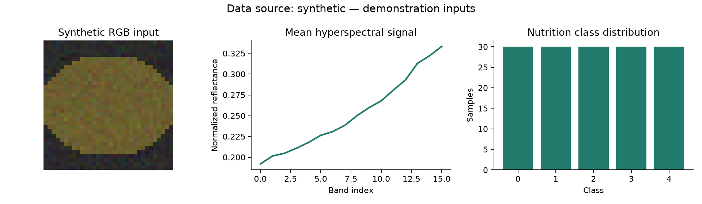
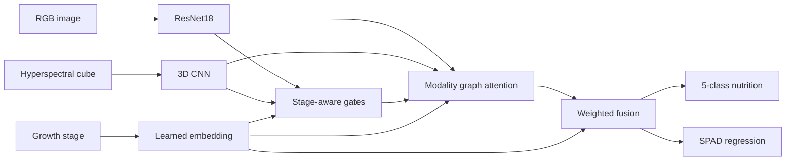
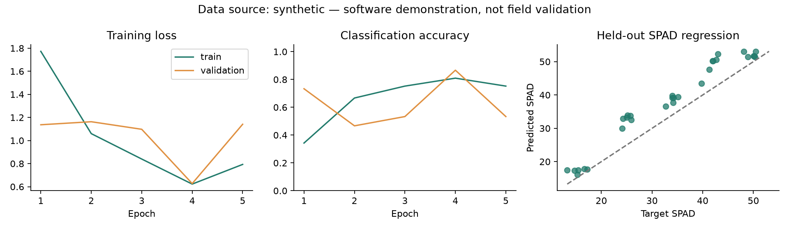

# Growth-aware multimodal learning

[](https://github.com/shiyaotang6-dev/growth-aware-multimodal/actions/workflows/tests.yml)

**RGB × 高光谱 × 生育期先验：营养等级分类与 SPAD 回归的个人实验项目。**

本仓库是一份新写的、独立的教学实现：根据 RGB / 高光谱双分支、生育期动态门控、模态图注意力、多任务学习这一思路搭建，可在 CPU 上完整运行。默认输入和标签全部由合成数据生成器产生；没有真实田间数据、原项目权重，也没有经过田间验证的准确率、R² 或边缘推理时延。这里的 `GAMT-Net-inspired` 指设计思路，不代表复现了某个未公开网络的完整结构与实验结论。



## 实现了什么

- **RGB 分支**：torchvision ResNet18，投影到统一特征维度。默认随机初始化，`--pretrained-rgb` 可启用 ImageNet 权重。
- **高光谱分支**：3D-CNN 处理 `[N, 1, bands, H, W]` 光谱立方体，保留光谱与空间邻域信息。
- **生育期先验**：3 个生育期的可学习 embedding，与两路特征一起预测 softmax 模态权重。
- **模态关联图**：两路特征作为图节点，生育期嵌入调制 query / key，通过多头注意力学习节点间关联；残差、LayerNorm 与前馈层进一步融合。
- **多任务输出**：5 类营养等级 + 连续 SPAD 值，交叉熵与归一化 SPAD SmoothL1 联合优化。
- **实验流程**：分组划分、训练集目标归一化、验证集选择 checkpoint、固定测试集评估、CSV 预测与图表输出。



## 5 分钟跑通

Python 3.10+。推荐使用独立环境；示例不需要 GPU、API Key 或下载数据。

```bash
python -m venv .venv
# Linux / macOS: source .venv/bin/activate
# Windows PowerShell: .venv\Scripts\Activate.ps1
python -m pip install --upgrade pip
python -m pip install torch torchvision --index-url https://download.pytorch.org/whl/cpu
python -m pip install -e .

python -m growth_demo.cli make-synthetic --output data/synthetic --samples 150 --seed 42
python -m growth_demo.cli --threads 2 train --manifest data/synthetic/manifest.csv --output runs/demo --epochs 5 --batch-size 16 --seed 42 --device cpu
python -m growth_demo.cli evaluate --manifest data/synthetic/manifest.csv --checkpoint runs/demo/best_model.pt --output runs/evaluation --device cpu
python -m growth_demo.cli report --manifest data/synthetic/manifest.csv --run runs/demo --output runs/report
python -m unittest discover -s tests -v
```

安装后也可以用 `growth-demo` 替代 `python -m growth_demo.cli`。全局参数 `--threads` 放在子命令之前。首次使用 `--pretrained-rgb` 会按 torchvision 的规则下载 ImageNet ResNet18 权重；评估已有 checkpoint 不需要重复下载。

输出包括 `best_model.pt`、`metrics.json`、`history.json`、`test_predictions.csv`。图表由 `report` 命令生成。数据和 checkpoint 默认被 `.gitignore` 排除，避免把大文件混入源码仓库。

## 已运行的合成实验

仓库中的图表与 [metrics.json](docs/example_metrics.json) 来自一次实际运行，命令与上方一致：150 个合成样本，seed 42，5 个 epoch，CPU，RGB 32×32、高光谱 16×8×8，训练 / 验证 / 测试为 105 / 15 / 30。结果只证明代码完成了训练与评估流程，不能用来推断真实作物上的表现。

| 测试集指标 | 本次合成实验 |
| --- | ---: |
| 五分类准确率 | 66.67% |
| SPAD MAE | 4.775 |
| SPAD RMSE | 5.495 |
| SPAD R² | 0.7942 |



环境：PyTorch 2.14.0+cpu、torchvision 0.29.0+cpu、NumPy 2.3.5，2 个 CPU 线程。不同依赖版本或硬件上的浮点结果可能变化。此示例使用可学习的合成信号，而非真实农学规律；没有 Jetson 部署、剪枝、量化或端到端时延测试。当前营养等级使用普通分类损失，尚未加入有序分类约束。

## 接入自己的数据

提供一个 UTF-8 CSV 文件，列名如下：

```csv
sample_id,plant_id,array_path,growth_stage,nutrition_class,spad
sample-001,plant-001,arrays/sample-001.npz,0,2,34.5
```

每个 NPZ 文件包含 `rgb` 与 `hsi` 两个数组：

| 字段 | 约定 |
| --- | --- |
| `rgb` | float32，`[3, H, W]`，H / W ≥32，数值 `[0, 1]` |
| `hsi` | float32，`[bands, H, W]`，每一维 ≥4，校准到 `[0, 1]` |
| `growth_stage` | 整数 0、1、2；映射含义由数据提供者定义 |
| `nutrition_class` | 整数 0–4；真实数据的等级阈值应预先定义 |
| `spad` | 有限连续数值；真实数据应来自明确的测量协议 |
| `plant_id` | 同株、同采样对象的重复采集必须使用同一 ID |

当前 DataLoader 要求同一 batch 内形状一致，真实输入应先统一空间分辨率和光谱波段。RGB 在 Dataset 内采用 ImageNet mean / std；高光谱在进入模型前应由数据提供者完成校准。不要根据整个数据集统计量做归一化或制定阈值。

划分先按 `plant_id` 分组，再按组的主要营养等级分层，目标比例约为 7:1:2。每类至少要有 3 个独立组；小数据集或多次采集会因取整和组大小产生比例偏差，但同一植株不会同时进入训练与测试。真实田间研究还应考虑按地块、日期或批次分组；随机植株划分不能替代跨地块泛化评估。

checkpoint 保存划分 ID、manifest SHA-256 和样本内容 SHA-256。`evaluate` 使用保存的测试样本，并拒绝元数据或 NPZ 内容已变化的数据。SPAD mean / std 只用训练集计算，测试集不参与 checkpoint 选择。

## 代码位置

```text
src/growth_demo/
├── model.py       # RGB / HSI 编码器、门控、图注意力、任务头
├── data.py        # 合成数据、CSV/NPZ 适配、分组划分、内容指纹
├── engine.py      # 训练、验证选择、固定测试集评估、预测输出
├── report.py      # 数据预览与实验图表
└── cli.py         # 命令行入口
tests/            # 梯度、数据边界、分组隔离与 checkpoint 测试
docs/             # 本次真实执行的合成实验产物
```

测试覆盖两路编码器、stage embedding、门控、图注意力的反向传播；不同生育期对融合的影响；分组隔离；重复样本 ID 拒绝；单轮训练与 checkpoint 重载；样本内容变化拒绝。GitHub Actions 使用 CPU 环境执行这些测试。

## 下一步实验

获得可公开或授权使用的真实数据后，可以比较 RGB-only、HSI-only、固定融合、去掉生育期先验、去掉图注意力等消融实验；增加有序分类损失、跨地块评估与 SPAD 回归误差分布，再单独建立硬件端到端时延基准。当前仓库没有把这些尚未执行的工作包装成已完成结果。

MIT License。
